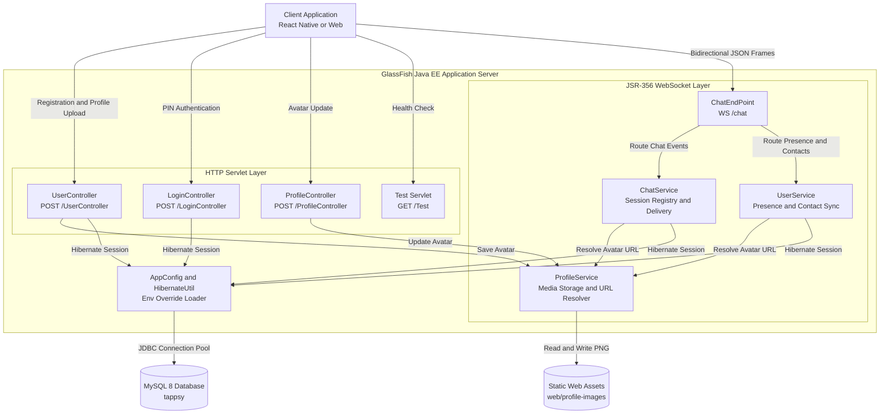
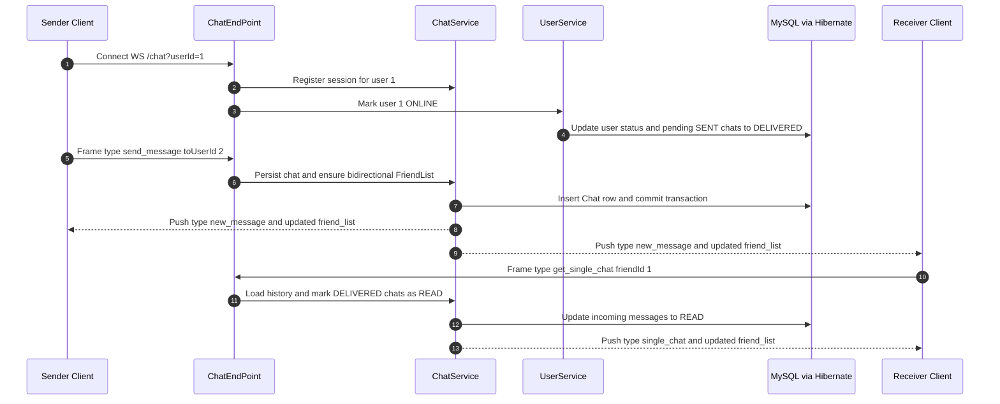
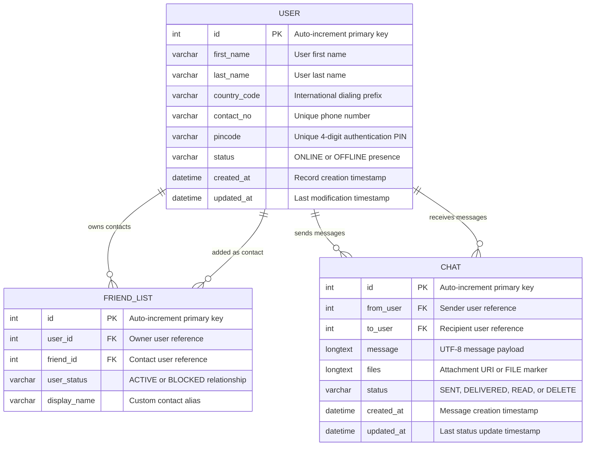

<div align="center">

# Tappsy Backend

**Real-time messaging backend powered by Java EE Servlets, JSR-356 WebSockets, Hibernate ORM, and MySQL 8.**  
Delivers low-latency bidirectional chat, online presence tracking, read receipts, contact discovery, and multipart profile media management.

[](https://openjdk.org/)
[](https://jakarta.ee/)
[](https://hibernate.org/)
[](https://www.mysql.com/)
[](https://github.com/google/gson)
[](LICENSE)

</div>

---

## System Architecture

Tappsy separates stateless onboarding/media HTTP endpoints from persistent, full-duplex WebSocket sessions managed in a thread-safe `ConcurrentHashMap` registry.



---

## Real-Time Messaging Lifecycle

When a user connects to `/chat?userId={id}`, their WebSocket session is registered, their presence flips to `ONLINE`, pending `SENT` messages from active contacts transition to `DELIVERED`, and both sender and recipient receive synchronized live updates on every new message.



---

## Database Entity-Relationship Model



---

## API & WebSocket Reference

### HTTP REST Endpoints

| Method | Endpoint | Content-Type | Description |
| :--- | :--- | :--- | :--- |
| `POST` | `/UserController` | `multipart/form-data` | Register a new user (`firstName`, `lastName`, `countryCode`, `contactNo`, `pincode`, `profileImage`). |
| `POST` | `/LoginController` | `multipart/form-data` or `application/x-www-form-urlencoded` | Authenticate an existing user by `contactNo` and 4-digit `pincode`. |
| `POST` | `/ProfileController` | `multipart/form-data` | Update a user's profile avatar (`userId`, `profileImage`). |
| `GET` | `/Test` | `application/json` | Lightweight service health-check endpoint returning `{"status": true, "service": "TappsyBackEnd"}`. |

### WebSocket Protocol (`ws://<host>/TappsyBackEnd/chat?userId=<id>`)

| Client Message `type` | Required Payload Fields | Server Response `type` |
| :--- | :--- | :--- |
| `PING` | — | `PONG` |
| `get_chat_list` | — | `friend_list` (list of `ChatSummary` with unread counts) |
| `get_single_chat` | `friendId` | `single_chat` + refreshed `friend_list` (marks incoming as `READ`) |
| `send_message` | `toUserId`, `message` | `new_message` + refreshed `friend_list` pushed to both participants |
| `send_chat` | `fromId`, `toId`, `message` | `chat` + refreshed `friend_list` pushed to both participants |
| `get_friend_data` | `friendId` | `friend_data` |
| `get_all_users` | — | `all_users` (active contacts mapped to `UserDTO`) |
| `save_new_contact` | `user` (`firstName`, `lastName`, `countryCode`, `contactNo`, `pincode`) | `new_contact_response_text` + refreshed `all_users` |
| `set_user_profile` | — | `user_profile` |

---

## Core Engineering Highlights

- **Concurrent Session Management:** Thread-safe `ConcurrentHashMap<Integer, Session>` maps active user IDs to live WebSocket sessions for instant O(1) message fan-out.
- **Hibernate ORM & Transactional Integrity:** JPA-annotated entities (`BaseEntity`, `User`, `FriendList`, `Chat`, `Status`) backed by `StandardServiceRegistryBuilder` and deterministic `try/finally` session lifecycle management.
- **Zero-Hardcoded-Secrets Configuration:** `AppConfig` and `HibernateUtil` automatically prioritize runtime environment variables (`DB_URL`, `DB_USER`, `DB_PASSWORD`, `PUBLIC_BASE_URL`, `LOCAL_BASE_URL`, `APP_CONTEXT_PATH`) over local XML defaults.
- **Automatic Delivery & Read Receipts:** Pending messages transition cleanly through `SENT` → `DELIVERED` (on recipient socket open) → `READ` (on thread retrieval), with live unread counters aggregated in `ChatSummary`.
- **Clean DTO Projection:** `UserDTO` and `ChatSummary` decouple internal Hibernate entities from serialized JSON payloads via Gson.

---

## Repository Structure

```text
TappsyBackEnd/
├── .env.example                       # Runtime environment variable template
├── LICENSE                            # MIT Open-Source License
├── README.md                          # Architecture & API documentation
├── build.xml                          # Apache Ant / NetBeans build script
├── database/
│   └── tappsy.sql                     # Clean MySQL 8 DDL schema
├── lib/                               # Hibernate 4.3, MySQL Connector/J, Gson, SLF4J JARs
├── nbproject/                         # NetBeans Java EE web project descriptors
├── src/
│   ├── conf/
│   │   └── MANIFEST.MF
│   └── java/
│       ├── hibernate.cfg.xml          # Local Hibernate mapping & connection defaults
│       ├── hibernate.cfg.xml.example  # Reference Hibernate configuration template
│       ├── controller/
│       │   ├── LoginController.java   # PIN-based authentication servlet
│       │   ├── ProfileController.java # Multipart profile avatar upload servlet
│       │   ├── Test.java              # JSON health-check servlet
│       │   └── UserController.java    # User registration servlet
│       ├── dto/
│       │   └── UserDTO.java           # Outbound user profile projection
│       ├── entity/
│       │   ├── BaseEntity.java        # Mapped superclass with audit timestamps
│       │   ├── Chat.java              # Message entity
│       │   ├── FriendList.java        # Bidirectional contact graph entity
│       │   ├── Status.java            # Presence and delivery state enum
│       │   └── User.java              # Account entity
│       ├── socket/
│       │   ├── ChatEndPoint.java      # JSR-356 @ServerEndpoint("/chat")
│       │   ├── ChatService.java       # Session registry, history & delivery service
│       │   ├── ChatSummary.java       # Inbox thread summary DTO
│       │   ├── ProfileService.java    # Disk persistence & avatar URL verification
│       │   └── UserService.java       # Online status, receipts & contact management
│       └── util/
│           ├── AppConfig.java         # Env / JVM property configuration helper
│           └── HibernateUtil.java     # SessionFactory singleton with env overrides
└── web/
    ├── WEB-INF/
    │   └── glassfish-web.xml          # GlassFish deployment descriptor
    ├── index.html                     # Backend status landing page
    └── profile-images/
        └── .gitkeep                   # Runtime avatar storage directory (ignored in git)
```

---

## Getting Started

### Prerequisites

- **JDK 8** (or compatible Java EE 8 runtime)
- **GlassFish 5 / Payara Server 5** (Servlet 3.1+ & JSR-356 WebSocket container)
- **MySQL 8.0+**
- **Apache NetBeans** (or Apache Ant)

### 1. Clone the Repository

```bash
git clone https://github.com/theekshana-sudeepa/TappsyBackEnd.git
cd TappsyBackEnd
```

### 2. Initialize the MySQL Database

Import the clean schema from `database/tappsy.sql`:

```bash
mysql -u root -p < database/tappsy.sql
```

### 3. Configure Environment Variables

Copy `.env.example` as a reference and configure the environment variables (or JVM `-D` system properties) in your GlassFish/Payara domain:

```bash
cp .env.example .env
```

| Variable | Description | Default |
| :--- | :--- | :--- |
| `DB_URL` | JDBC connection URL for MySQL | `jdbc:mysql://localhost:3306/tappsy?useSSL=false&allowPublicKeyRetrieval=true` |
| `DB_USER` | MySQL database username | `root` |
| `DB_PASSWORD` | MySQL database password | *(empty)* |
| `PUBLIC_BASE_URL` | Public base URL returned to clients for profile images (e.g., reverse proxy or tunnel URL) | `http://localhost:8080` |
| `LOCAL_BASE_URL` | Internal base URL used for avatar HEAD verification | `http://localhost:8080` |
| `APP_CONTEXT_PATH` | Deployed web context path | `/TappsyBackEnd` |

### 4. Build & Deploy

1. Open the project in **Apache NetBeans** and link your local **GlassFish Server** runtime.
2. Clean and build the project (`TappsyBackEnd.war`) and deploy to GlassFish.
3. Verify the server is live:

```bash
curl http://localhost:8080/TappsyBackEnd/Test
# {"status":true,"service":"TappsyBackEnd"}
```

---

## License

Distributed under the **MIT License**. See [LICENSE](LICENSE) for full details.

---

<div align="center">

**Author**  
**Theekshana Sudeepa** — [LinkedIn](https://www.linkedin.com/in/theekshana-sudeepa/) · [GitHub](https://github.com/theekshana-sudeepa) · [LexoraTech](https://lexoratech.com)

</div>
